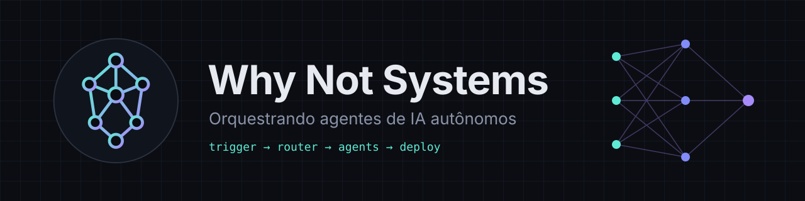
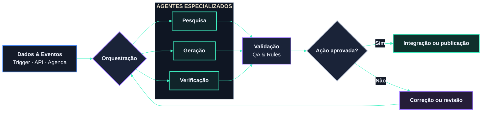

  

# Por que não construir sistemas melhores?

A **Why Not Systems** é uma equipe de engenharia de IA que transforma tarefas repetíveis em sistemas autônomos.

Projetamos agentes, orquestramos fluxos de trabalho e usamos dados, código e verificações automáticas para construir soluções que operam com mais consistência e menos intervenção manual.

## No que trabalhamos

- Agentes de IA especializados
- Orquestração e automação de fluxos
- Integração com APIs e serviços externos
- Geração e processamento de dados
- Sistemas com validação e publicação controlada

## Como pensamos

- Agentes pequenos e independentes
- Responsabilidades claras
- Decisões baseadas em dados
- Verificação antes da execução ou publicação
- Automatização modular e fácil de manter

## Como funciona

